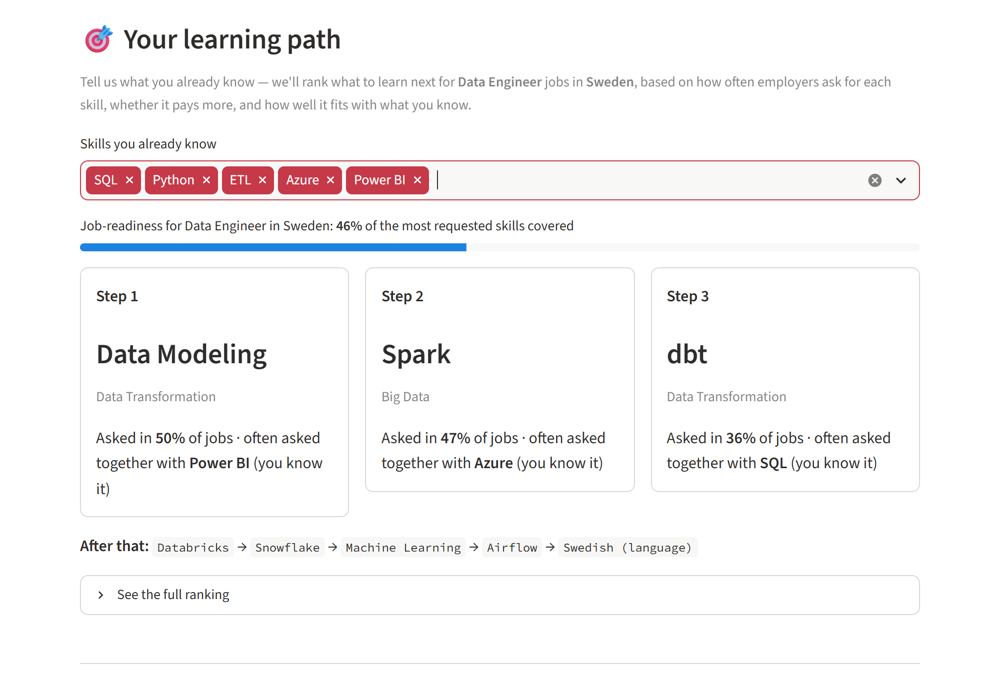
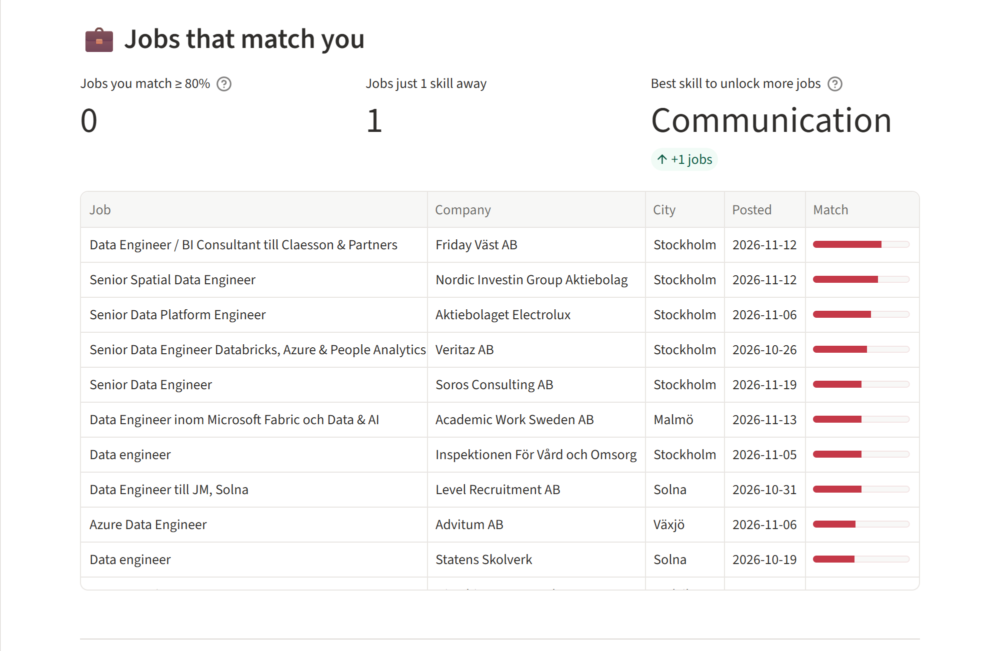
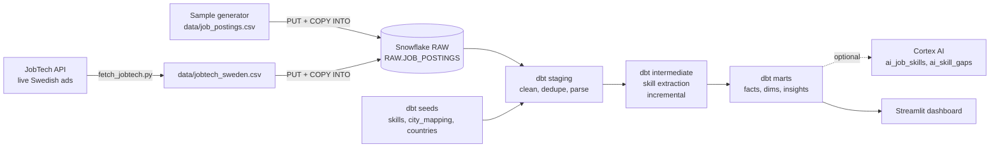

# 📊 Job Market Skills Analyzer
**Which skills should I learn to get a job?** — an end-to-end data project with **Snowflake + dbt + Streamlit**.

[](../../actions/workflows/ci.yml)
[](../../actions/workflows/daily_refresh.yml)

Two data sources, switchable in the dashboard:
- **🇸🇪 Real data** — ~2,700 live Data/IT job ads from Arbetsförmedlingen's Platsbanken
  (the open [JobTech API](https://jobtechdev.se)), refreshed automatically every morning.
- **🌍 Sample data** — 12,000 synthetic postings across 8 countries (India, Sweden, Norway,
  Denmark, Germany, Netherlands, UK, US) with salaries, for country and salary comparisons.

**🚀 Live dashboard:** https://job-market-skills-analyzer.streamlit.app
— real Swedish job ads, refreshed every morning.

**📚 dbt docs (models, tests, lineage graph):** https://pujitha-pitta.github.io/job-market-skills-analyzer/

| Your learning path | Jobs that match you |
|---|---|
|  |  |

Job postings are loaded into Snowflake, cleaned and modelled with dbt, and every
skill mentioned in each job description is extracted. The result answers the
questions every student asks:

| Question | Where the answer lives |
|---|---|
| What skills do Data Engineer jobs ask for? | `mart_skill_demand` |
| Which skills pay more? | `mart_salary_by_skill` |
| What do **fresher** jobs need? | `mart_fresher_skills` |
| Is GenAI / dbt / Snowflake growing? | `mart_skill_trends` |
| If I learn SQL, what should I learn with it? | `mart_skill_pairs` |
| Which city has the most jobs and best pay? | `mart_city_overview` |
| How does Sweden compare with other countries? | Streamlit "Compare countries" |
| I know SQL + Excel — what next? | Streamlit "Your learning path" |
| Which real Swedish ads do I already match? Which skill unlocks the most? | Streamlit "Jobs that match you" (links to each ad) |
| What does the regex miss? | `ai_skill_gaps` (optional, Snowflake Cortex) |

---

## 🏗️ Architecture



**dbt lineage:**
```
source: raw.job_postings ─┐
seed:   city_mapping ─────┴─► stg_job_postings ─┬─► int_job_skills (incremental) ─┐
seed:   skills ─────────────────────────────────┘                                  │
                                                stg_job_postings + int_job_skills ─► int_jobs_enriched
int_jobs_enriched ─► fct_job_postings ─► fct_job_skills, dim_skills
                                      └► mart_skill_demand, mart_salary_by_skill, mart_fresher_skills,
                                         mart_skill_trends, mart_skill_pairs, mart_city_overview
```

## 🧰 What this project demonstrates

| Skill | Where |
|---|---|
| Snowflake RBAC (roles, least privilege), warehouse cost control | `snowflake/01_setup.sql` |
| Internal stage, file format, `PUT` / `COPY INTO`, load metadata | `snowflake/02_load_raw_data.sql`, `ingestion/` |
| Layered dbt modelling (staging → intermediate → marts) | `dbt_project/models/` |
| Seeds as configurable reference data | `seeds/skills.csv`, `seeds/city_mapping.csv` |
| Custom macros (regex skill matching, salary parsing, role classification) | `dbt_project/macros/` |
| Incremental model with `merge` | `int_job_skills.sql` |
| Data cleaning: dedupe with `QUALIFY`, mixed date formats, salaries in 6 currencies and many local formats (LPA, kr/mån, € p.a., £k …) | `stg_job_postings.sql` |
| Generic + singular data tests, a custom generic test | `*.yml`, `tests/` |
| dbt `grants` + `on-run-end` hooks | `dbt_project.yml` |
| Star schema (fact + bridge + dimension) | `marts/core/` |
| Analytics SQL: window functions, co-occurrence & lift, median salary premium | `marts/career/` |
| Interactive dashboard, safe parameter binding | `dashboard/streamlit_app.py` |
| REST API ingestion with paging, retries and rate limiting | `ingestion/fetch_jobtech.py` |
| Bilingual (Swedish + English) skill and role matching | `seeds/skills.csv`, `macros/classify_role.sql` |
| CI (compile, smoke tests, `dbt parse`) + scheduled daily refresh | `.github/workflows/` |
| LLM extraction inside the warehouse, compared with the regex | `models/marts/ai/` |

---

## 🚀 Setup (≈ 30 minutes)

### 0. Prerequisites
- A free **Snowflake trial** account → https://signup.snowflake.com (choose Enterprise, any cloud, region close to you)
- **Python 3.10+**

### 1. Install Python packages
```powershell
cd job-market-skills-analyzer
python -m venv --without-pip .venv
python -m pip --python .\.venv\Scripts\python.exe install -r requirements.txt
```
> On this PC `ensurepip` is broken and Windows Application Control blocks the `dbt.exe` /
> `streamlit.exe` launchers, so this project runs everything through the venv's Python:
> `.\dbt <command>` inside `dbt_project\` (a small `dbt.cmd` shortcut) and
> `..\.venv\Scripts\python.exe run_dashboard.py` for the dashboard.

### 2. Create the Snowflake objects
Open Snowsight → **Projects » Worksheets** → new SQL worksheet → paste and run
[`snowflake/01_setup.sql`](snowflake/01_setup.sql) (run all).

### 3. Generate and load the data
**One command does everything** (sample data + live Swedish ads → Snowflake → `dbt build`):
```powershell
.\.venv\Scripts\python.exe run_pipeline.py     # asks for account, login and password once
```
Or step by step:
```powershell
.\.venv\Scripts\python.exe data_generator/generate_job_postings.py   # writes data/job_postings.csv (~12,480 rows)
.\.venv\Scripts\python.exe ingestion/fetch_jobtech.py                # writes data/jobtech_sweden.csv (live ads, no key needed)

.\.venv\Scripts\python.exe ingestion/load_to_snowflake.py --truncate --file data/job_postings.csv data/jobtech_sweden.csv
```
> The loader, `run_dbt.py` and `run_dashboard.py` all ask for anything not already set in
> `SNOWFLAKE_ACCOUNT` / `SNOWFLAKE_USER` / `SNOWFLAKE_PASSWORD`. The password prompt is hidden and nothing is saved.
> **Account identifier:** in Snowsight click your name (bottom-left) → *Connect a tool to Snowflake* → copy the **Account identifier** (looks like `ORGNAME-ACCOUNTNAME`).
> **MFA:** if password login is blocked, create a *Programmatic Access Token* (your profile → Settings → Authentication) and use it as `SNOWFLAKE_PASSWORD`.

Prefer clicking? Follow the manual steps in [`snowflake/02_load_raw_data.sql`](snowflake/02_load_raw_data.sql).

### 4. Run dbt
```powershell
cd dbt_project
..\.venv\Scripts\python.exe run_dbt.py build   # easiest: asks for your login, then seeds + models + tests
# or, with SNOWFLAKE_ACCOUNT / SNOWFLAKE_USER / SNOWFLAKE_PASSWORD set:
.\dbt debug          # checks the connection
.\dbt seed           # loads skills.csv + city_mapping.csv
.\dbt build          # runs all models + all tests
.\dbt docs generate
.\dbt docs serve     # opens docs + lineage graph in your browser
```

Useful commands:
```powershell
.\dbt build --select stg_job_postings+                    # one model and everything downstream
.\dbt build --full-refresh --select int_job_skills+       # after editing seeds/skills.csv
.\dbt test --select mart_skill_demand
```

### 5. Run the dashboard
```powershell
cd ..\dashboard
..\.venv\Scripts\python.exe run_dashboard.py     # asks for your Snowflake login, opens http://localhost:8501
```
> Prefer a saved login? Copy `.streamlit\secrets.toml.example` to `.streamlit\secrets.toml`, fill it in,
> and run `..\.venv\Scripts\python.exe -m streamlit run streamlit_app.py` instead (never commit that file).
**Or host it inside Snowflake:** Snowsight → *Projects » Streamlit* → *+ Streamlit App* → database `JOB_MARKET_DB`, schema `MARTS`, warehouse `TRANSFORM_WH` → paste `streamlit_app.py` → Run. (Use role `TRANSFORMER`; add `altair` in *Packages* if asked.)

### 6. Explore with SQL
Run [`snowflake/03_explore_marts.sql`](snowflake/03_explore_marts.sql) for ready-made questions.

---

## 📁 Project structure
```
job-market-skills-analyzer/
├── data_generator/generate_job_postings.py   # realistic, messy sample data
├── data/job_postings.csv                     # generated file
├── ingestion/
│   ├── fetch_jobtech.py                      # live Swedish ads from the JobTech API
│   └── load_to_snowflake.py                  # PUT + COPY INTO
├── run_pipeline.py                           # fetch + load + dbt build in one go
├── .github/workflows/                        # ci.yml, daily_refresh.yml
├── snowflake/
│   ├── 01_setup.sql                          # roles, warehouse, db, stage, raw table
│   ├── 02_load_raw_data.sql                  # manual load + checks
│   └── 03_explore_marts.sql                  # example analysis queries
├── dbt_project/
│   ├── dbt_project.yml  profiles.yml
│   ├── seeds/            skills.csv, city_mapping.csv, countries.csv
│   ├── macros/           classify_role, text_contains_skill, parse_salary_yearly, rollup_role_and_country, generate_schema_name
│   ├── models/
│   │   ├── staging/      stg_job_postings
│   │   ├── intermediate/ int_job_skills (incremental), int_jobs_enriched
│   │   └── marts/
│   │       ├── core/     fct_job_postings, fct_job_skills, dim_skills
│   │       ├── career/   mart_skill_demand, mart_salary_by_skill, mart_fresher_skills,
│   │       │             mart_skill_trends, mart_skill_pairs, mart_city_overview
│   │       └── ai/       ai_job_skills, ai_skill_gaps (optional, Cortex)
│   └── tests/            singular tests + generic/unique_combination
└── dashboard/streamlit_app.py
```

## 🇸🇪 About the real data
- Source: Arbetsförmedlingen's [JobSearch API](https://jobsearch.api.jobtechdev.se) — open data, no API key.
  `fetch_jobtech.py` takes the whole *Data/IT* occupation field, paging back in time with `published-before`
  (the API caps the offset at 2,000).
- Every real row has `data_source = 'Real'`; sample rows are `'Sample'`. All marts keep them apart, so
  real and synthetic numbers never mix.
- **Salaries:** Swedish ads almost never publish pay ("Lön enligt överenskommelse"), so real mode shows
  demand, trends, cities and job matching, and points to sample data for salary questions.
- Many ads are in Swedish, so the skill dictionary and role rules include Swedish wording
  (e.g. *maskininlärning*, *flytande svenska*, *systemutvecklare*).

## ⏰ GitHub: CI and daily refresh
1. Create an empty GitHub repo and push this folder (`.gitignore` keeps out `.venv`, `data/*.csv`,
   `target/` and `secrets.toml`).
2. **CI** ([`ci.yml`](.github/workflows/ci.yml)) runs on every push: compiles the Python, smoke-tests the generator
   and the JobTech fetcher, and runs `dbt parse`. No secrets needed.
3. **Daily refresh** ([`daily_refresh.yml`](.github/workflows/daily_refresh.yml)) runs `run_pipeline.py` every
   morning at 05:00 UTC (or on demand: *Actions → Daily refresh → Run workflow*). Add three repository secrets
   (*Settings → Secrets and variables → Actions*): `SNOWFLAKE_ACCOUNT`, `SNOWFLAKE_USER`, `SNOWFLAKE_PASSWORD`
   — use a **Programmatic Access Token** rather than your real password.
4. Each run uses about a minute of the X-Small warehouse.
5. The same workflow publishes the **dbt docs** to GitHub Pages (*Settings → Pages → Source: GitHub Actions*).

## 🤖 Optional: Cortex AI skill extraction
`models/marts/ai/` asks an LLM inside Snowflake (Cortex `AI_COMPLETE`, default `llama3.1-8b`) to list the
skills in the 300 newest real ads, then compares its answers with the regex dictionary:
```powershell
cd dbt_project
..\.venv\Scripts\python.exe run_dbt.py build --select ai_job_skills+ --vars "{enable_cortex: true}"
```
```sql
select * from marts.ai_skill_gaps where not in_dictionary order by ads_mentioning desc;  -- skills to add to skills.csv
select * from marts.ai_skill_gaps where in_dictionary order by regex_agreement;         -- where the regex misses
```
Off by default: it costs a few credits per run, needs Cortex in your account's region
(or cross-region inference enabled), and **does not work on Snowflake free-trial accounts**
(AI functions are blocked until the account is upgraded). Change the model or sample size with
`--vars "{enable_cortex: true, cortex_model: 'mistral-large2', cortex_sample_size: 100}"`.

## 🌱 Ideas to extend
- **Snapshots (SCD2)**: keep ads after they close, to build longer trends.
- **Adzuna API** for real ads in other countries (free key required).
- **Masking policy** on company names for a "privacy" demo.
## 📝 Resume bullet points
- Built an end-to-end ELT pipeline on **Snowflake** and **dbt** that ingests ~2,700 live Swedish job ads daily from a public REST API, identifying in-demand skills and trends by role and city.
- Designed a layered dbt project (staging → intermediate → marts) with an **incremental** bilingual (Swedish/English) skill-extraction model, custom macros, and 70+ automated data tests.
- Automated the pipeline with **GitHub Actions** (CI checks on every push, scheduled daily refresh).
- Compared regex extraction with an LLM running in-warehouse (**Snowflake Cortex**) to find skills the dictionary missed.
- Delivered a **Streamlit** dashboard with a personalised learning path and "jobs you already match", linking to the real ads.
